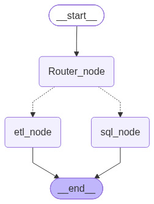
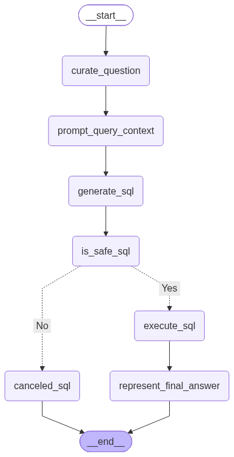

<h1 align="center">
  🤖 Agentic Data Analyst
</h1>

<p align="center">
  <strong>A multi-agent AI system that turns natural language into SQL queries and ETL pipelines — powered by Google Gemini & LangGraph.</strong>
</p>

<p align="center">
  
  
  
  
  
</p>

---

## 📖 Overview

**Agentic Data Analyst** is an intelligent, multi-agent system that allows you to interact with your data using plain English. Simply describe what you need — the system automatically routes your request to the most appropriate specialist agent:

| Your Request | Agent Invoked |
|---|---|
| *"List all films with a rental rate > $4"* | 🔍 **SQL Analyst** |
| *"Extract data from this API and save it as CSV"* | 🔄 **ETL Analyst** |

The system is built with **LangGraph** for agent orchestration and uses **Google Gemini** as its LLM backbone, making it both powerful and highly extensible.

---

## 🏗️ Architecture

The system is composed of three layers of agents:

```
User Input
    │
    ▼
┌─────────────────────────────────┐
│         Data Agent (Router)     │  ← Classifies intent
└────────────┬────────────────────┘
             │
     ┌───────┴───────┐
     ▼               ▼
┌─────────┐   ┌────────────┐
│   SQL   │   │    ETL     │
│ Analyst │   │  Analyst   │
└────┬────┘   └─────┬──────┘
     │               │
     ▼               ▼
  Answer        Data Files
```

### Agent Graphs

<table>
  <tr>
    <th align="center">🗺️ Data Agent (Router)</th>
    <th align="center">🔍 SQL Analyst</th>
    <th align="center">🔄 ETL Analyst</th>
  </tr>
  <tr>
    <td align="center"></td>
    <td align="center"></td>
    <td align="center"></td>
  </tr>
</table>

---

## ✨ Features

- **🧭 Intelligent Routing** — A router agent classifies each request and dispatches to the right specialist agent.
- **🔍 SQL Analyst** — Converts natural language to safe, executable PostgreSQL queries with a built-in **SQL safety judge** to prevent destructive operations.
- **🔄 ETL Analyst** — Extracts data from REST APIs, transforms it using AI-generated Pandas code, and saves it in your chosen format (JSON, CSV, Parquet).
- **🛡️ Safe-by-default** — Every SQL query is reviewed by a judge LLM before execution. INSERT, UPDATE, DELETE, DROP, etc. are automatically blocked.
- **⚡ Multi-LLM tiers** — Uses tiered LLM selection (`low`, `medium`, `high`) so you can balance speed vs. capability per task.
- **🗃️ Schema-aware** — The SQL agent reads your live database schema at query time for accurate, context-aware SQL generation.

---

## 🗂️ Project Structure

```
Agentic-Data-Analyst/
├── agents/
│   ├── Data_Agent.py        # Top-level router agent
│   ├── sql_analyst.py       # SQL generation & execution agent
│   └── ETL_Analyst.py       # Extract, Transform & Load agent
├── Models/
│   └── schema.py            # Pydantic state schemas for all agents
├── utils/
│   ├── database.py          # PostgreSQL connection & query utilities
│   ├── etl_tools.py         # ETL helper functions (extract, transform, execute)
│   └── llm_pick.py          # Tiered LLM selector (low / medium / high)
├── data/
│   ├── extract/             # Raw data extracted from APIs
│   └── transform/           # Transformed & processed data outputs
├── main.py                  # Interactive CLI entrypoint
├── pyproject.toml           # Project metadata & dependencies (uv)
├── uv.lock                  # Locked dependency versions
├── .env.example             # Environment variable template
└── .gitignore
```

---

## 🚀 Getting Started

### Prerequisites

- Python **3.14+**
- [`uv`](https://docs.astral.sh/uv/) package manager
- A **PostgreSQL** database
- A **Google AI Studio** API key ([get one here](https://aistudio.google.com/app/apikey))

### 1. Clone the repository

```bash
git clone https://github.com/your-username/Agentic-Data-Analyst.git
cd Agentic-Data-Analyst
```

### 2. Install dependencies

```bash
uv sync
```

### 3. Configure environment variables

```bash
cp .env.example .env
```

Then edit `.env` with your actual credentials:

```env
GOOGLE_API_KEY=your_google_api_key_here

DB_HOST=localhost
DB_PORT=5432
DB_USER=your_db_username
DB_PASSWORD=your_db_password
DB_NAME=your_db_name
```

### 4. Run the agent

```bash
uv run python main.py
```

You will see an interactive prompt:

```
AI Data Agent
Type 'exit' to quit
You: List all films that have a rental rate greater than $4.00
```

---

## 💬 Usage Examples

### SQL Queries (Natural Language → PostgreSQL)

```
You: How many customers have rented more than 30 films?
You: List the top 5 most rented movie categories
You: What is the average rental duration per store?
```

### ETL Pipelines

```
You: Extract data from https://pokeapi.co/api/v2/pokemon and save it to data/extract as CSV
You: Transform the file at data/extract/data.csv, filter rows where hp > 50, and save as parquet
```

> ⚠️ **Safety Note**: The SQL agent will automatically **reject** any query that attempts to modify data (INSERT, UPDATE, DELETE, DROP, etc.).

---

## ⚙️ Configuration

### LLM Tiers

The `pick_llm()` utility in [`utils/llm_pick.py`](utils/llm_pick.py) lets each agent select the appropriate model tier:

| Tier | Usage |
|------|-------|
| `low` | Fast tasks — question curation, final answer formatting |
| `medium` | Standard tasks — SQL generation, routing |
| `high` | Complex tasks — ETL code generation |

To swap models, edit `utils/llm_pick.py`.

---

## 🛠️ Tech Stack

| Component | Technology |
|---|---|
| Agent Orchestration | [LangGraph](https://github.com/langchain-ai/langgraph) |
| LLM Provider | [Google Gemini](https://ai.google.dev/) via `langchain-google-genai` |
| Data Manipulation | [Pandas](https://pandas.pydata.org/) |
| Database | [PostgreSQL](https://www.postgresql.org/) via `psycopg2` |
| Schema Validation | [Pydantic v2](https://docs.pydantic.dev/) |
| Package Manager | [uv](https://docs.astral.sh/uv/) |

---

## 👤 Author

**Salmane MOHADDAB**

- GitHub: [@smohaddab](https://github.com/SalmaneMohaddab)
- Email: salmanemohaddab@gmail.com


